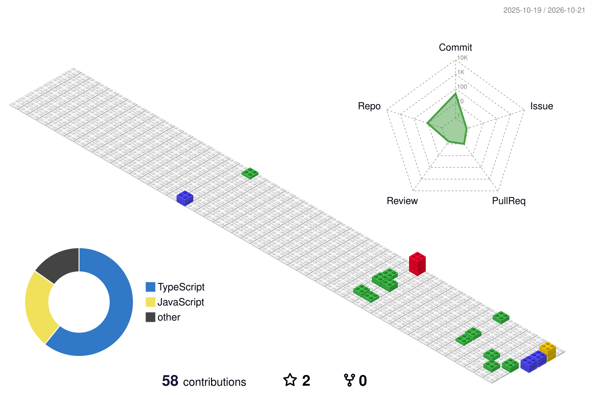

# Hi there 👋, I'm NewNiThi

### 🚀 Developer & Builder

---

## 📊 3D GitHub Contributions

  <picture>
    <source media="(prefers-color-scheme: dark)" srcset="./profile-3d-contrib/profile-night-rainbow.svg" />
    <source media="(prefers-color-scheme: light)" srcset="./profile-3d-contrib/profile-gitblock.svg" />
    
  </picture>

<!-- 
💡 หากต้องการเปลี่ยนรูปแบบกราฟ 3D สามารถเปลี่ยน path ด้านบนเป็นไฟล์อื่นที่ระบบสร้างให้ได้ดังนี้:
- ./profile-3d-contrib/profile-gitblock.svg             (แบบตัวต่อ Git Block)
- ./profile-3d-contrib/profile-green-animate.svg        (แบบสีเขียว มี Animation)
- ./profile-3d-contrib/profile-green.svg                (แบบสีเขียวปกติ)
- ./profile-3d-contrib/profile-night-rainbow.svg        (โหมดกลางคืน สีรุ้ง)
- ./profile-3d-contrib/profile-night-green.svg          (โหมดกลางคืน สีเขียวเรืองแสง)
- ./profile-3d-contrib/profile-night-view.svg           (โหมดกลางคืน โทนเมือง)
- ./profile-3d-contrib/profile-season-animate.svg       (โทนตามฤดูกาล มี Animation)
-->

---

## 🛠️ Highlighted Repositories

- 🎫 **[service-ticket](https://github.com/NewNiThI2531/service-ticket)** — Lightweight, self-hosted ITSM ticket management system for Incident and Problem tracking (`TypeScript`)
- 📦 **[inventorybox-production](https://github.com/NewNiThI2531/inventorybox-production)** — Production InventoryBox app connected to Supabase and Cloudinary
- 🌐 **[holosphere-web](https://github.com/NewNiThI2531/holosphere-web)** — Web application project
- 🤖 **[pantheon-ai](https://github.com/NewNiThI2531/pantheon-ai)** — AI project
- 💬 **[hush-chat](https://github.com/NewNiThI2531/hush-chat)** — Chat application
- 🎨 **[koro-collective](https://github.com/NewNiThI2531/koro-collective)** — TypeScript web project

---

## 📈 GitHub Stats

  
  

